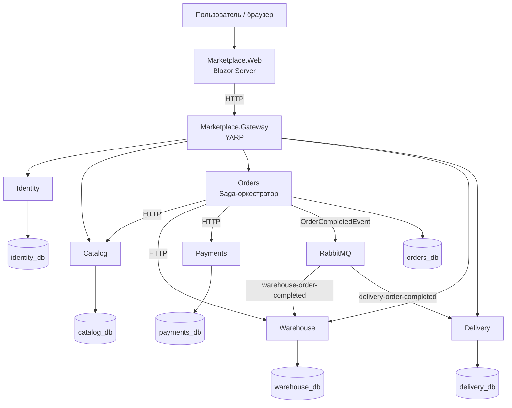
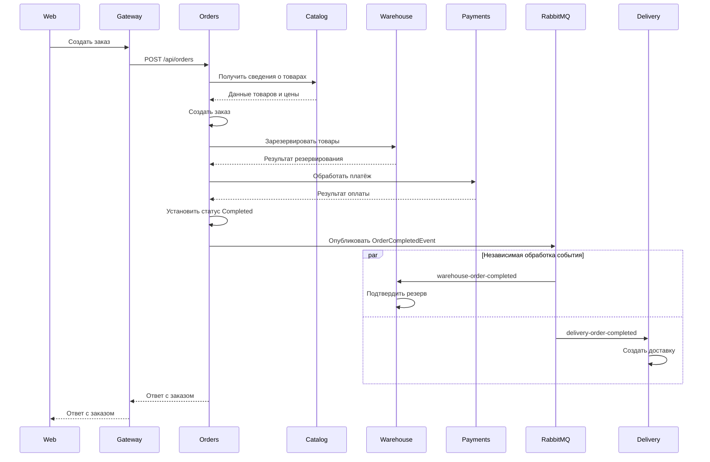
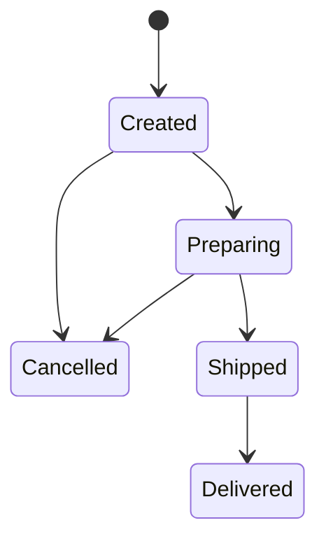

# Архитектура системы Marketplace

**Тема:** «Маркетплейс с заказами на событиях» (тема 3)  
**Студент:** Кабкуев Сааду  
**Период практики:** 21.10.2026 — 16.12.2026

## 1. Общая информация

Marketplace — учебное веб-приложение, построенное на микросервисной архитектуре.

Каждый бизнес-микросервис владеет собственной базой PostgreSQL. Сервисы взаимодействуют синхронно через HTTP и асинхронно через события RabbitMQ.

Процесс оформления заказа координируется сервисом Orders с использованием паттерна **Saga с оркестратором**. Orders управляет последовательностью операций резервирования товара и оплаты, а при ошибках выполняет предусмотренные компенсирующие действия.

Система включает:

- шесть бизнес-микросервисов;
- API Gateway;
- Web-приложение на Blazor Server;
- шесть отдельных баз PostgreSQL;
- брокер сообщений RabbitMQ.

## 2. Технологический стек

| Компонент | Технология |
|---|---|
| Платформа | .NET 10 |
| Backend | ASP.NET Core Minimal API |
| Web-клиент | Blazor Server |
| API Gateway | YARP Reverse Proxy |
| ORM | Entity Framework Core 10 |
| Базы данных | PostgreSQL 16 |
| Брокер сообщений | RabbitMQ 3 |
| Работа с сообщениями | MassTransit |
| Аутентификация | JWT |
| Логирование | Serilog |
| Документация API | Swagger / Swashbuckle |
| Тестирование | xUnit, Moq |
| Контейнеризация | Docker |
| Оркестрация | Docker Compose |
| Непрерывная интеграция | GitHub Actions |

## 3. Микросервисы и ответственность

| Сервис | Ответственность | База данных |
|---|---|---|
| Identity | Регистрация, аутентификация, пользователи, роли и JWT | `identity_db` |
| Catalog | Товары, категории и корзина | `catalog_db` |
| Orders | Заказы и оркестрация Saga | `orders_db` |
| Warehouse | Складские остатки и резервы | `warehouse_db` |
| Payments | Имитация обработки платежей | `payments_db` |
| Delivery | Создание доставки и управление её статусом | `delivery_db` |
| Gateway | Маршрутизация API-запросов и проверка JWT | Не используется |
| Web | Пользовательский интерфейс на Blazor Server | Не используется |

Каждый бизнес-микросервис отвечает за собственные данные и схему базы. Прямой доступ одного микросервиса к базе другого не используется.

## 4. Общая схема архитектуры

## 5. Взаимодействие сервисов

### 5.1. Синхронное взаимодействие по HTTP

HTTP используется для операций, в которых вызывающей стороне нужен непосредственный ответ.

Примеры:

- Web обращается к backend через API Gateway.
- Orders запрашивает сведения о товарах у Catalog.
- Orders запрашивает резервирование товаров у Warehouse.
- Orders передаёт запрос на имитацию оплаты в Payments.

### 5.2. Асинхронное взаимодействие через RabbitMQ

После успешного завершения заказа сервис Orders публикует событие `OrderCompletedEvent`.

Событие независимо обрабатывается двумя Consumer:

| Consumer | Очередь RabbitMQ |
|---|---|
| `Warehouse.OrderCompletedConsumer` | `warehouse-order-completed` |
| `Delivery.OrderCompletedConsumer` | `delivery-order-completed` |

Это две независимые очереди. Каждый сервис получает собственную копию события, поэтому обработка в Warehouse не заменяет обработку в Delivery.

## 6. Оформление заказа и паттерн Saga

Сервис Orders выступает оркестратором Saga и координирует жизненный цикл заказа.

### 6.1. Успешное оформление заказа

1. Orders получает от Catalog информацию о товарах и ценах.
2. Orders создаёт заказ.
3. Orders запрашивает у Warehouse резервирование требуемых товаров.
4. Orders отправляет запрос в Payments.
5. При успешной оплате Orders устанавливает заказу статус `Completed`.
6. Orders публикует `OrderCompletedEvent` в RabbitMQ.
7. Warehouse обрабатывает свою копию события, подтверждает резерв и списывает зарезервированное количество.
8. Delivery обрабатывает свою копию события и создаёт запись о доставке.

### 6.2. Компенсирующие действия

Если операция в процессе Saga завершается ошибкой, Orders выполняет предусмотренные компенсирующие действия.

Примеры:

- При неуспешной оплате резерв товара освобождается.
- Заказ получает соответствующий статус отмены или ошибки в зависимости от пути выполнения.
- Освобождённый резерв нельзя подтвердить как успешно завершённый.

## 7. Контракт события

Основное интеграционное событие — `OrderCompletedEvent`.

Оно содержит:

- `OrderId` — идентификатор заказа;
- `ReservationId` — идентификатор резерва на складе;
- `DeliveryAddress` — адрес доставки.

Событие публикует Orders после успешного завершения заказа.

Warehouse использует идентификаторы заказа и резерва для подтверждения резервирования. Delivery использует данные события для создания записи доставки.

## 8. Жизненный цикл доставки

Запись о доставке создаётся асинхронно после успешного завершения заказа и обработки события сервисом Delivery.

Поддерживаемые статусы:

- `Created` — доставка создана;
- `Preparing` — подготовка к отправке;
- `Shipped` — отправлена;
- `Delivered` — доставлена;
- `Cancelled` — отменена.

Допустимые переходы:

Недопустимые переходы отклоняются сервисом Delivery. Например, завершённую доставку `Delivered` нельзя вернуть в `Preparing`.

API Delivery предоставляет операции:

- получение списка доставок;
- получение доставки по её ID;
- получение доставки по `OrderId`;
- изменение статуса доставки.

## 9. Владение базами данных

Каждый бизнес-сервис использует собственную базу PostgreSQL.

| База данных | Владелец |
|---|---|
| `identity_db` | Identity |
| `catalog_db` | Catalog |
| `orders_db` | Orders |
| `warehouse_db` | Warehouse |
| `payments_db` | Payments |
| `delivery_db` | Delivery |

Для управления схемами используются миграции Entity Framework Core.

## 10. API Gateway

API Gateway построен на YARP Reverse Proxy.

Основные маршруты:

| Маршрут | Сервис назначения |
|---|---|
| `/api/auth` | Identity |
| `/api/products` | Catalog |
| `/api/cart` | Catalog |
| `/api/orders` | Orders |
| `/api/stocks` | Warehouse |
| `/api/deliveries` | Delivery |

Для защищённых маршрутов Gateway проверяет JWT-токен.

## 11. Docker-архитектура

В `docker/docker-compose.yml` описано 15 сервисов:

- 6 контейнеров PostgreSQL;
- 1 контейнер RabbitMQ;
- 6 контейнеров бизнес-микросервисов;
- 1 контейнер API Gateway;
- 1 контейнер Web-приложения.

Контейнеры приложений взаимодействуют друг с другом внутри Docker-сети по именам Compose-сервисов и внутреннему HTTP-порту `8080`.

Для сборки приложений используется общий файл `docker/Dockerfile.service`, а для запуска всей системы — `docker/docker-compose.yml`.

Базы данных и RabbitMQ используют именованные тома для сохранения данных между перезапусками контейнеров.

## 12. Автоматизированное тестирование

Тестовый проект расположен в `tests/Marketplace.Tests`.

Текущий набор включает:

| Область | Количество тестов |
|---|---:|
| Бизнес-логика Delivery | 21 |
| Интеграционные тесты Consumer Warehouse | 5 |
| **Всего** | **26** |

Тесты Delivery проверяют создание объекта, валидацию входных данных, допустимые и недопустимые переходы статусов.

Тесты Warehouse используют настоящий PostgreSQL и проверяют обработку события Consumer, подтверждение резерва, защиту от повторного списания, обработку освобождённого резерва и откат транзакции при несогласованных остатках. Контекст сообщения MassTransit для этих тестов подменяется тестовым объектом.

## 13. Непрерывная интеграция

Workflow GitHub Actions находится в `.github/workflows/ci.yml`.

Pipeline выполняет следующие действия:

1. Получает исходный код репозитория.
2. Устанавливает .NET 10 SDK.
3. Запускает PostgreSQL как сервис для интеграционных тестов.
4. Восстанавливает NuGet-зависимости.
5. Собирает решение в конфигурации Release.
6. Запускает автоматизированные тесты.

## 14. Ограничения

- Платёжная обработка имитируется; внешний платёжный провайдер не подключён.
- Транзакционный Outbox не реализован.
- Обработка RabbitMQ асинхронная, поэтому запись о доставке может появиться в интерфейсе с небольшой задержкой после завершения заказа.
- Учётные данные Docker Compose предназначены для локального запуска и демонстрации, а не для production-среды.
